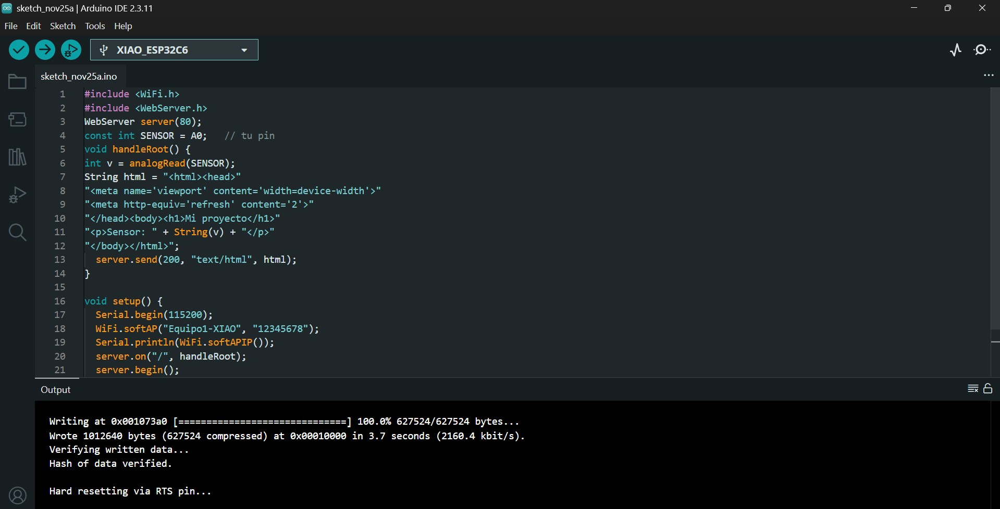
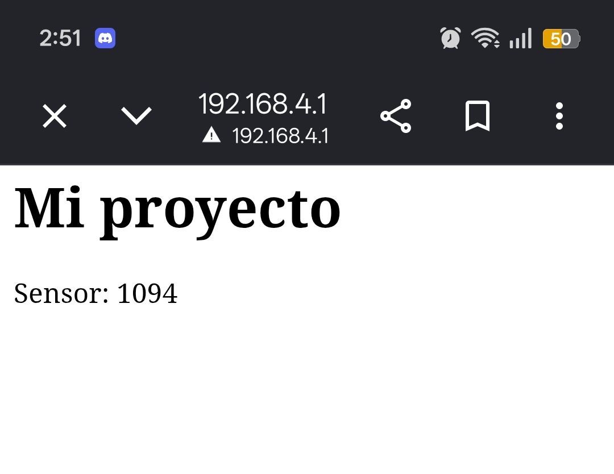
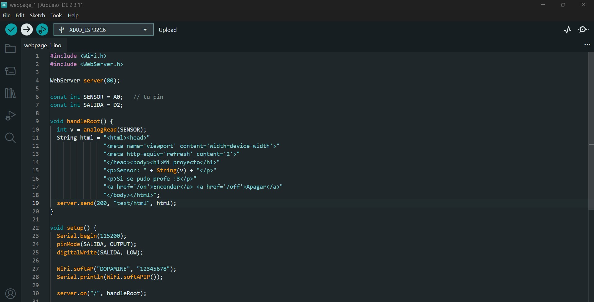
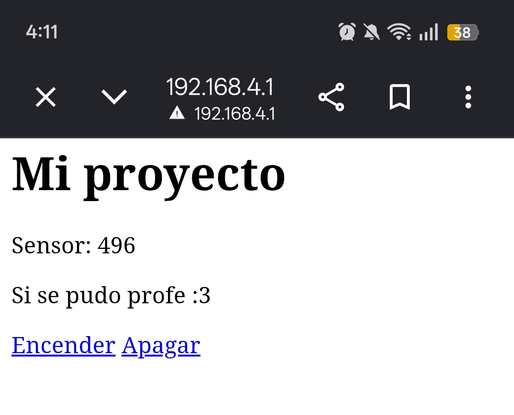

Para empezar, Copie el Código de la presentación 




Posteriormente, utilice mi celular para conectarme a la red, ya que no le cambie el nombre a esta, me conecte a la red de "Equipo 1 Xiao" la cual estaba en el Código por defecto, al ingresar la dirección IP en el buscador de google me apareció la pagina 




La revisar la presentación, me di cuenta que aun tenia Código por agregar, siguiendo las instrucciones, aggrege el Código en sus respectivos apartados.

Un dato que es importante notar, es que realizamos la prueba casi al mismo tiempo, así que requerimos cambiar el nombre de la red y su contraseña, en mi caso decidí usar "Dopamine" con la misma contraseña "12345678"



Y después de hacer los ultimo cambios al Código, puse la dirección IP en el buscador y obviamente funciono como se esperaba, agregando una Linea de texto extra 



---
## Codigo final

```
#include <WiFi.h>

#include <WebServer.h>

  

WebServer server(80);

  

const int SENSOR = A0;   // tu pin

const int SALIDA = D2;

  

void handleRoot() {

  int v = analogRead(SENSOR);

  String html = "<html><head>"

                "<meta name='viewport' content='width=device-width'>"

                "<meta http-equiv='refresh' content='2'>"

                "</head><body><h1>Mi proyecto</h1>"

                "<p>Sensor: " + String(v) + "</p>"

                "<p>Si se pudo profe :3</p>"

                "<a href='/on'>Encender</a> <a href='/off'>Apagar</a>"

                "</body></html>";

  server.send(200, "text/html", html);

}

  

void setup() {

  Serial.begin(115200);

  pinMode(SALIDA, OUTPUT);

  digitalWrite(SALIDA, LOW);

  

  WiFi.softAP("DOPAMINE", "12345678");

  Serial.println(WiFi.softAPIP());

  

  server.on("/", handleRoot);

  

  server.on("/on", []() {

    digitalWrite(SALIDA, HIGH);

    server.sendHeader("Location", "/");

    server.send(303);

  });

  

  server.on("/off", []() {

    digitalWrite(SALIDA, LOW);

    server.sendHeader("Location", "/");

    server.send(303);

  });

  

  server.begin();

}

  

void loop() {

  server.handleClient();

}
```