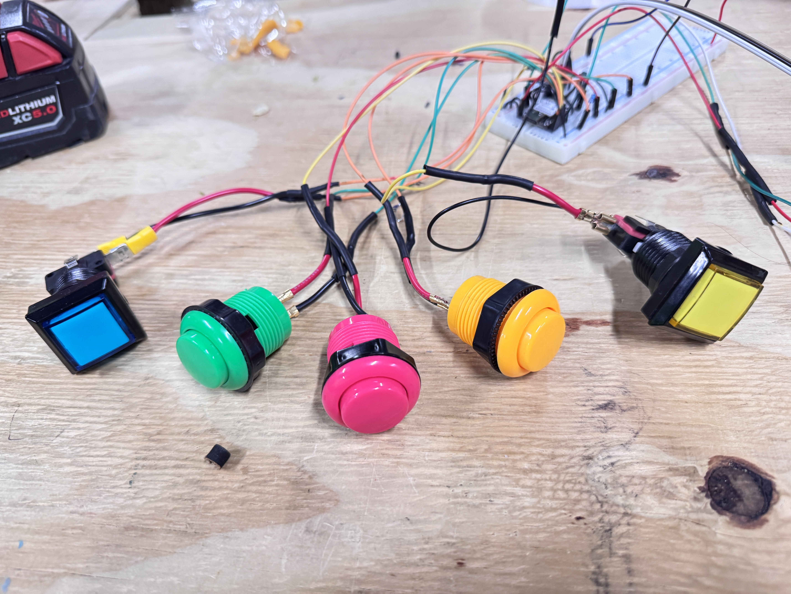

**Proyecto:** Dopamine Trap · Cofre interactivo

---

## ¿Qué hacen?

Los botones son la forma en que el jugador interactúa con el cofre. A través de ellos se resuelve el reto de memoria, un juego que se explicará más adelante en su propio documento. Cada botón tiene un color distinto y está asociado a un nombre, una luz y un sonido, para que el jugador pueda reconocerlo con facilidad.

---

## Materiales

|Material|Especificación|Cantidad|
|---|---|---|
|Botón arcade redondo|Opaco, colores naranja, rosa y verde|3|
|Botón arcade cuadrado|Translúcido, colores azul y amarillo|2|
|Terminales faston|Para conectar los cables a las patitas del botón|10|
|Cable de calibre delgado|Un cable de color para cada botón y negro para tierra|10 tramos|
|XIAO ESP32-C6 (XIAO JUEGO)|Lee qué botón se presiona|1|

**Voltaje:** el interruptor de cada botón soporta hasta 250 V y 3 A, muy por encima de lo que necesitamos. En nuestro circuito solo pasa la señal de 3.3 V de la XIAO, por lo que trabajan con total seguridad. Los botones cuadrados incluyen un foco de 12 V que no utilizamos, ya que el circuito opera a 5 V y 3.3 V.

---

## ¿Por qué elegimos estos botones?

- **Son grandes y llamativos:** su tamaño invita a presionarlos y atrae la atención del jugador desde el primer momento.
- **Son fáciles de localizar:** durante el juego hay que reaccionar rápido, y un botón grande se encuentra sin esfuerzo.
- **Tienen colores distintos:** cada color se identifica al instante, lo que facilita memorizar las combinaciones. Además, los colores vivos son lo primero que capta la atención de los niños, el público principal del proyecto.
- **Son resistentes:** están diseñados para máquinas de videojuegos, por lo que soportan presiones repetidas y con fuerza.

---

## ¿Cómo funcionan?

### El microswitch

Debajo de cada botón hay un pequeño interruptor llamado **microswitch**, con tres patitas:

|Patita|Significado|Comportamiento|
|---|---|---|
|**COM**|Común|Es la patita de referencia; se conecta a tierra (GND)|
|**NO**|Normalmente abierto|Solo se une con COM mientras el botón está presionado|
|**NC**|Normalmente cerrado|Está unida con COM cuando el botón está suelto|

Utilizamos **COM y NO**, porque así el circuito solo se cierra en el momento en que el jugador presiona el botón. La patita NC queda sin conectar.

### Resistencia interna (INPUT_PULLUP)

Cada pin de la XIAO que lee un botón se configura con una resistencia interna que lo mantiene en estado **alto (HIGH)** mientras el botón está suelto. Al presionarlo, el botón une el pin con tierra y la lectura cambia a **bajo (LOW)**. De esta forma, la XIAO sabe exactamente cuándo se presiona cada botón sin necesidad de agregar resistencias externas al circuito.

### Antirrebote

Al presionar un botón, el contacto metálico interno vibra durante algunos milisegundos y puede generar varias lecturas en lugar de una sola. Para evitarlo, el programa confirma la pulsación después de una breve pausa y espera a que el botón se suelte antes de leer la siguiente. Así, cada presión cuenta una sola vez.

---

## Librerías utilizadas

Los botones no requieren ninguna librería externa. Las funciones para configurar los pines y leer su estado ya vienen incluidas en el entorno de XIAO, lo que hace que este componente sea sencillo de programar.

---

## Investigación y referencias

Para entender cómo conectar los botones consultamos foros en línea y buscamos imágenes de referencia del circuito. La mayoría de los diagramas estaban hechos para **Arduino**, así que nos guiamos principalmente con una imagen de conexión para Arduino y la adaptamos a los pines de nuestra XIAO ESP32-C6, lo cual si fue un poco difícil pero nos apoyamos de mucho apoyo (Gracias al Profe Rafa y Alumnos de mecatrónica que nos guiaron bastante)

Las terminales faston fueron la parte que más nos costó entender. Fue necesario ver varios videos para aprender cómo se colocan y se aprietan correctamente sobre el cable.

---

## Conexiones

Todos los botones se conectan de la misma forma: la patita **COM** va a tierra y la patita **NO** va a su pin en la XIAO.

|Botón|Color|Patita NO va a|Patita COM va a|
|---|---|---|---|
|1|Naranja|D0|GND|
|2|Rosa|D1|GND|
|3|Verde|D2|GND|
|4|Azul|D3|GND|
|5|Amarillo|D8|GND|

## Problemas que tuvimos y cómo los resolvimos

| Problema                                       | Causa                                                                                                                                                                                        | Solución                                                                                                                           |
| ---------------------------------------------- | -------------------------------------------------------------------------------------------------------------------------------------------------------------------------------------------- | ---------------------------------------------------------------------------------------------------------------------------------- |
| Algunos botones fallaban o no respondían       | Los cables no estaban bien sujetos en las terminales faston y no hacían buen contacto                                                                                                        | Vimos varios videos para aprender a colocar y apretar las terminales correctamente, y volvimos a conectar los botones que fallaban |
| No sabíamos cómo colocar las terminales faston | Era la primera vez que trabajábamos con este tipo de conectores                                                                                                                              | Investigamos con videos tutoriales hasta entender el procedimiento                                                                 |
| Duda sobre qué patitas usar                    | El microswitch tiene tres patitas, y aparte unos botones con led son de 4, donde las laterales son solo para el led, y la frontal y base son ya para lo que viene siendo conexión del botón. | Identificamos COM y NO, y dejamos NC sin conectar                                                                                  |

## Conclusión

Los botones arcade le dan al cofre una forma de interacción clara, divertida y fácil de entender para cualquier persona. Su tamaño y sus colores cumplen una doble función: atraen la atención del jugador y facilitan el reto de memoria. Aunque su conexión parecía sencilla, nos enseñaron que una buena unión entre cable y terminal es tan importante como el propio componente.

