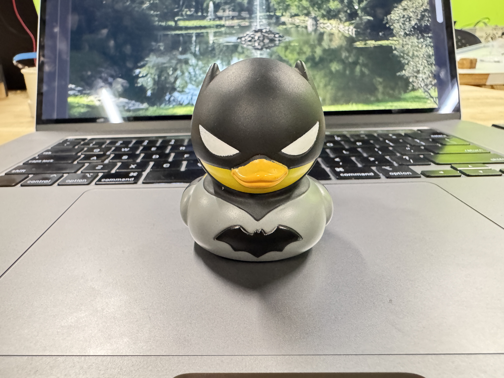

### Modelado 3D y captura con la app

Para el modelado en bambú para la impresión, ocupé una aplicación de celular que sirve para crear los modelados, que se llama **AR Code**. Esta app te pide un video donde toma 25 fotos por sección desde 3 ángulos: de frente, más arriba y más abajo; luego lo convierte en su modelo 3D.

Igual esta app sirve bastante cuando cuentas con LiDAR en tu celular, ya que logra dimensionar mejor las figuras y proximidades. Por ello es que igual mi modelo salió bastante similar.

### Preparación en Bambu Lab

Una vez teniendo esto, ya fue más fácil. El modelo que me proporcionó lo exporté a **Bambu Lab**, donde solo me quedaba definir bien qué soportes usar, que en este caso fue una cuadrícula. Esto para que no quedara pesado, porque si poníamos otro tipo de relleno, la cuadrícula evita que esté muy pesado.

Ahora sí, arriba está un botón para partir en platos (_Slice Plate_). De ahí ya solo se exportó y se pasó a una tarjeta SD, la cual se insertó en la impresora 3D (en este caso fue una **Bambu Lab A1**).

### El tropiezo con el primer filamento

A la hora de imprimir nos surgieron varios problemas, pero bueno. En la primera impresión se dieron líneas feas y se trabó la punta con el filamento, esto porque el filamento estaba muy húmedo. Por ello fue que después se tuvo que cambiar el filamento.

Gracias a esto aprendí a cómo limpiar una punta, quitar ese exceso de filamento, cómo retirar el filamento y, sobre todo, la importancia del cuidado de los filamentos. Pero bueno, una vez cambiado el filamento —que la verdad es bastante sencillo, solo que la primera vez da miedo porque es algo nuevo, y es una impresora 3D, por lo que tenemos que tener cuidado—, el primer intento no quedó del todo bien. La impresión salió con una línea en medio del pato y se trabó porque la punta falló, entonces no se acabó de imprimir y quedaba con líneas demasiado marcadas o poco estéticas.

### La versión definitiva: El toque gótico de Batman

Pero bueno, luego se cambió el filamento, ahora a color negro —más Batman obvio, soy el señor de la noche—. Y bueno,ahora sí salió súper bien, tardó 42 minutos. Quedó muy bien de detalle y las líneas se ven bien; incluso el filamento negro le da un toque más gótico, muy Batman. Al final, ese pequeño tropiezo del filamento estuvo súper bien y valió la pena. Y bueno, así quedó el producto final.

