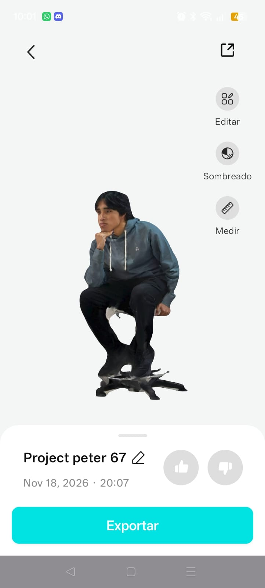

Primero, para crear un modelo, escaneamos nuestro compañero Pedro con la aplicación de Kiri

La app nos exportaba el modelo en un formato el cual no es apto para la impresión, así que utilizamos una pagina web que nos permitía cambiar el formato de .obj a .3mf

