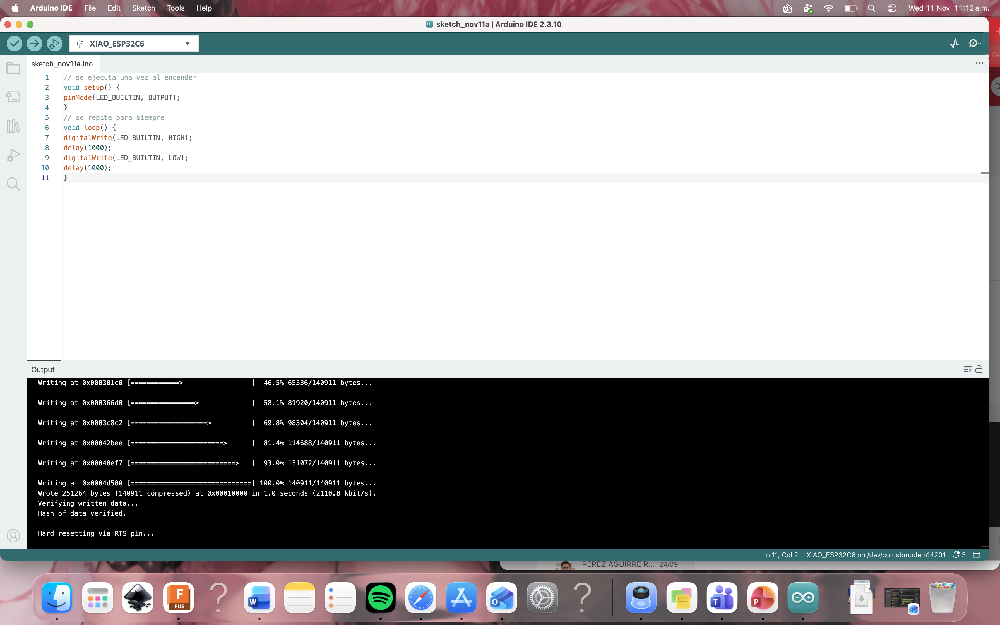
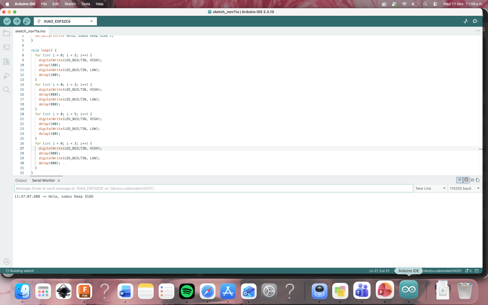

Evidencias por integrante del equipo de las pruebas realizadas del XIAO, están ordenadas por integrante, primer parpadeo, saludo, un video del parpadeo y finalmente del soldado.

### Danae Hernandez Saavedra

#### Tu primer parpadeo real
Este se hizo en base al código adjuntado en la presentación 

#### Haz que tu XIAO salude
Saludo de acuerdo a lo esperado, se copio el código de la presentación y después para el parpadeó lo modifique para que fuera rápido muy rápido  y despues que lo hiciera de una manera muy lenta, casi llegando a la normalidad

#### Video de como es mi parpadeo 
Aquí se puede observar como es el parpadeó configurado.

	Si aparece un "?" porfavor de un click en el icono y debería aparecer: (Sorry about that, but we can’t show files that are this big right now.) Y arriba de ese texto en morado o azul aparecerá "View raw", al darle click a esas dos palabra se descargará el video o abrirá una pagina con el video. Una disculpa por las molestias (｡>﹏<)

### Jose Leonardo Diaz

#### Tu primer parpadeo real
Cargar el codigo fue facíl, pero un error no permitia que funcione
![[blink dia.png]]
#### Haz que tu XIAO salude
La modificación fue sencilla

![[Saludodiaz.png]]

#### Video de como es mi parpadeo 

![[videosDiaz.mp4]]

### Jose Pedro Macuil 

#### Tu primer parpadeo real
En si fue fácil hacer esto ya que solo es copiar y pegar el código de un solo parpadeo 
![[Pipop.png]]
#### Haz que tu XIAO salude
Este fue mas difícil ya que, me daba error a no tener bien colocada la Xiao, el modelo en el que se tenia que correr era el incorrecto, entonces pues no se podía correr. Pero después ya 
![[Piposaludo.png]]
#### Video de como es mi parpadeo 
Por fin parpadea, Después de resetear ya parpadea
![[EspPipo.mp4]]