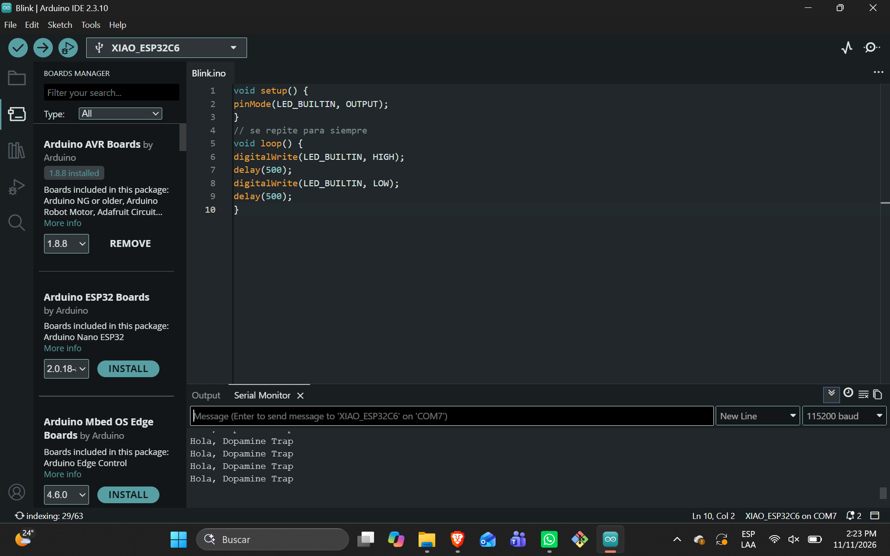
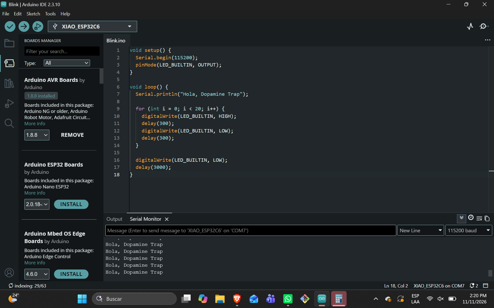

Evidencias por integrante del equipo de las pruebas realizadas del XIAO, están ordenadas por integrante, primer parpadeo, saludo, un video del parpadeo y finalmente del soldado.

### Danae Hernandez Saavedra

#### Tu primer parpadeo real
Este se hizo en base al código adjuntado en la presentación 

#### Haz que tu XIAO salude
Saludo de acuerdo a lo esperado, se copio el código de la presentación y después para el parpadeó lo modifique para que fuera rápido muy rápido  y despues que lo hiciera de una manera muy lenta, casi llegando a la normalidad

#### Video de como es mi parpadeo 
Aquí se puede observar como es el parpadeó configurado.

	Si aparece un "?" porfavor de un click en el icono y debería aparecer: (Sorry about that, but we can’t show files that are this big right now.) Y arriba de ese texto en morado o azul aparecerá "View raw", al darle click a esas dos palabra se descargará el video o abrirá una pagina con el video. Una disculpa por las molestias (｡>﹏<)

#### Hora de la Soldadura
Bueno para empezar en el proceso de soldadura primero hay que saber que ocupar, los materiales en gran parte y el proceso de como soldar son gracias a la presentación tacion que subió Rafa, sin la presentación la verdad que hubiera sido casi imposible hacerlo.

Ahora si, antes de explicar el proceso, enseñare los materiales ocupados en este mismo.

![[Soldadura1Danne.jpg]]
*(Imagen modificada con IA para colocar texto)

Pasando más a la acción, veremos como se coloco la pieza con las pinzas de soporte, la cual la verdad fue una gran ayuda, aunque a la hora de soldar la pieza para lograr que se quedaran juntas las patitas y la xiao lo hice con el dedo sosteniendo las patitas, donde descubrí que el calor si se pasa aunque no se agarre de manera directa, y si pasa demasiado calor ( ꩜ ᯅ ꩜;) ... (No murio mi dedo pero sentí como si hubiera puesto el dedo en una plancha)

![[Soldadura2Danne.JPG]]

Close up de como se ve la xiao agarrada por el soporte

![[Soldadadura3Danne.JPG]]

Ahora antes de empezar a soldar la pieza primero se prepara una superficie, donde ocupe una jeringa con flux, esto sirve para limpiar el metal, mejorar la fluidez y proteger contra el calor

![[Soldadura4Danne.JPG]]

Ahora si, ya tenemos el entorno listo y podemos empezar a soldar, mostraré como quedo el primer lado, si ves cual fue el error felicidades, tienes ojo de águila.

![[Soldadura7Danne.JPG]]

![[Soldadura8Danne.JPG]]

![[Soldadura5Danne.JPG]]

Fue la primera vez que soldaba, la verdad si me tarde bastante, pero fui con calma, checando  como iba quedando cada soldadura y sobretodo siguiendo las instrucciones, es decir se pega el cautin 3 segundos, y después se coloca el alambre, lleva tiempo pero quede chulísima la soldadura pero aun así tenía algunos errores porque no quedaba tal cual como un volcán, por lo cual se mejoró la estructura usando la presentación subida, donde viene que hacer en cada situación y ahora si, así quedo finalmente, con mucha paciencia.

![[Soldadura9Danne.JPG]]

![[Soldadura10Danne.JPG]]

### Jose Leonardo Diaz

#### Tu primer parpadeo real
Cargar el codigo fue facíl, pero un error no permitia que funcione
![[blink dia.png]]
#### Haz que tu XIAO salude
La modificación fue sencilla

![[Saludodiaz.png]]

#### Video de como es mi parpadeo 

![[videosDiaz.mp4]]

#### Hora de la Soldadura
-inserta imagen y breve texto-

### Jose Pedro Macuil 

#### Tu primer parpadeo real
En si fue fácil hacer esto ya que solo es copiar y pegar el código de un solo parpadeo 

#### Haz que tu XIAO salude
Este fue mas difícil ya que, me daba error a no tener bien colocada la Xiao, el modelo en el que se tenia que correr era el incorrecto, entonces pues no se podía correr. Pero después ya 

#### Video de como es mi parpadeo 
Por fin parpadea, Después de resetear ya parpadea

#### Hora de la Soldadura
-inserta imagen y breve texto-